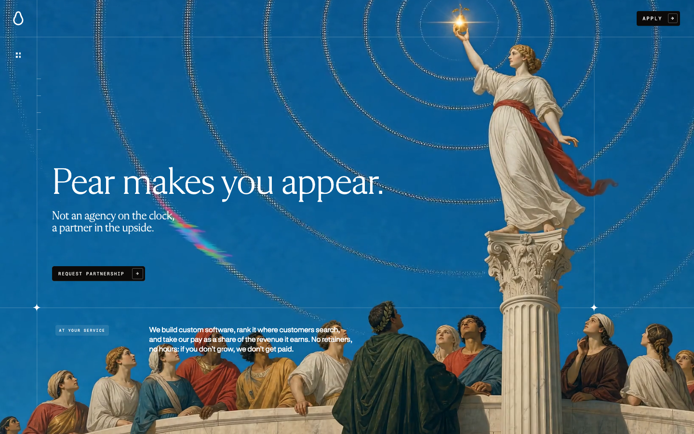
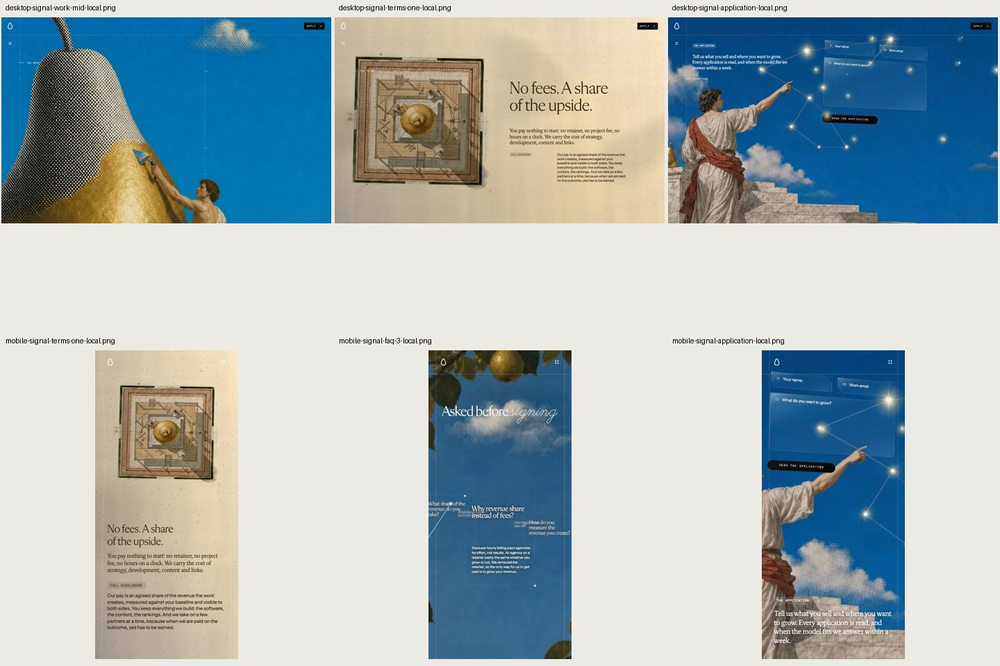
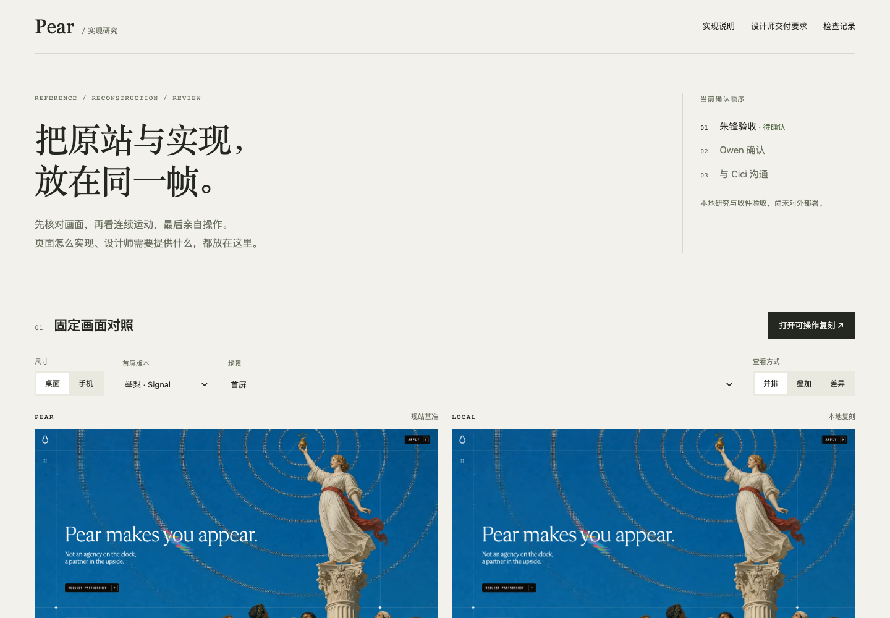
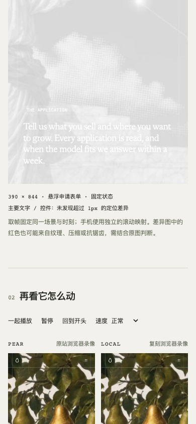
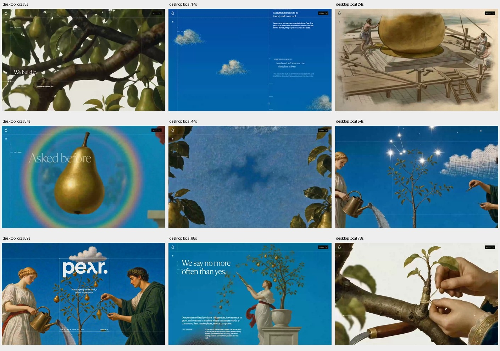
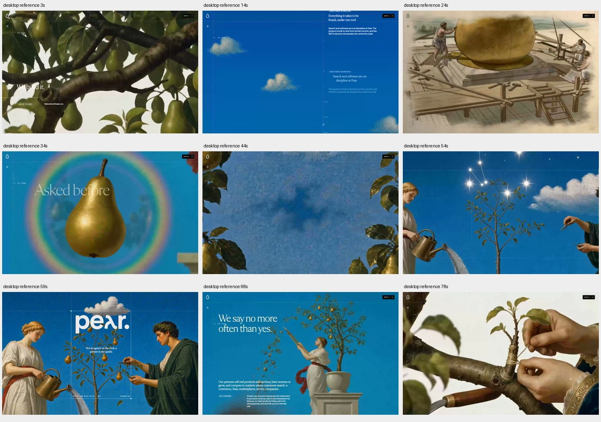
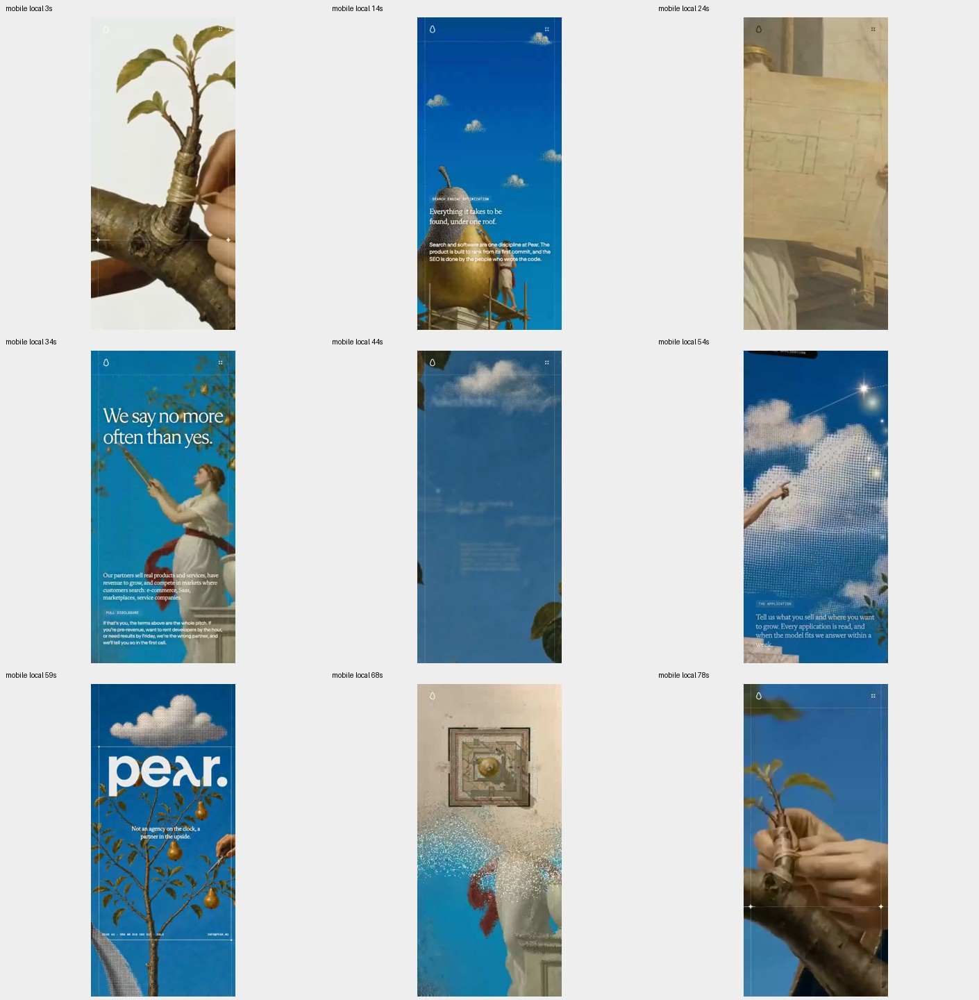

# Pear Code Reconstruction · 顶级官网 1:1 代码级复刻与自动化验收方法论

> 一套可复用的高复杂动效官网复刻工程范式：**研究拆解 → 像素级代码重建 → 静态可读降级 → 双端逐帧与 Diff 自动化验收**。本仓库以 Pear 官网（2026-09-15 快照）为研究样本，完整沉淀了从设计刻度、滚动画布、多端适配到自动化 E2E 与帧级对比的全套代码与证据链。

<p align="center">
  
</p>

## 为什么值得看这套复刻方法论

大多数“仿站 / 复刻”只做到静态截图像，一滚动就露馅、一缩屏幕就错位、一关 JS 就白屏。这个项目的核心目标不是“画一个长得像的页面”，而是建立一套**可量化、可回归、可溯源的官网重建工程流程**：

1. **边界诚实原则**：能用代码实现的排版、动效、状态机与纸面纹理全部用代码实现；原始绘画与连续视频帧单独在 `docs/reference-assets.json` 与 `docs/video-provenance.json` 中建账溯源，不把视频播放冒充程序生成。
2. **像素级三图对照（Reference / Local / Diff）**：每个关键滚动节点自动截取原站参考图、本地实现图与像素差异图，拒绝凭肉眼“差不多”。
3. **全场景鲁棒性门禁**：覆盖桌面端（1440 / 1280 / 768）、移动端（390 / 320）、WebKit 引擎、`prefers-reduced-motion` 减弱动效以及无 JS 静态阅读降级（`?reader=1`）。
4. **内置独立评审看板（`/review/`）**：将截图、对照数据、正反向滚动录像与文档集成在本地评审页，验收不再靠翻文件夹。

## 视觉与动效验收证据

### 1. 全站视觉总览与评审看板

<p align="center">
  
</p>

| 桌面端评审看板 (`/review/`) | 移动端响应式验收 (`390px`) |
|---|---|
|  |  |

### 2. 滚动动效逐帧对照（Desktop & Mobile Motion Sheets）

| 本地代码实现（Desktop Motion Sheet） | 原站参考基准（Reference Motion Sheet） |
|---|---|
|  |  |

| 本地代码实现（Mobile Motion Sheet） | 原站参考基准（Reference Motion Sheet） |
|---|---|
|  |  |

### 3. 真实浏览器正反向滚动录像（MP4）

- 桌面端滚动录像：[Colossus 场景](./verification/generated/motion-desktop-colossus-local.mp4) · [Reveal 场景](./verification/generated/motion-desktop-reveal-local.mp4)
- 移动端滚动录像：[Colossus 场景](./verification/generated/motion-mobile-colossus-local.mp4) · [Reveal 场景](./verification/generated/motion-mobile-reveal-local.mp4)

## 本地运行与自动化验收

```bash
# 1. 安装依赖并构建预览
npm ci
npm run build
npm run preview
```

启动后可访问以下入口（仅监听本机，表单提交仅落盘 `.local/inbox/applications.ndjson`，不向任何第三方发送）：

- 主站预览：`http://127.0.0.1:4187/`
- 对照、录像与评审看板：`http://127.0.0.1:4187/review/`
- 无 JS 静态阅读模式：`http://127.0.0.1:4187/?reader=1`
- 固定首屏调试：`?hero=signal` / `?hero=colossus` / `?hero=reveal`

```bash
# 2. 运行确定性验收与 E2E 回归
npm run verify
npm run test:e2e
node scripts/test-frame-refresh.mjs
node scripts/test-review.mjs
```

> 浏览器检查默认使用 macOS Google Chrome（可通过 `CHROME_PATH` 指定）；WebKit 检查需先运行 `npx playwright-core install webkit`；`node scripts/record-motion.mjs` 可重新录制真实浏览器的正反向滚动视频。

## 工程文档索引

- [验收约定 (ACCEPTANCE.md)](docs/ACCEPTANCE.md)
- [实现架构说明 (IMPLEMENTATION.md)](docs/IMPLEMENTATION.md)
- [UI/UX 设计交付标准 (DESIGN-HANDOFF.md)](docs/DESIGN-HANDOFF.md)
- [检查结果与未验证项 (VERIFICATION.md)](docs/VERIFICATION.md)
- [设计刻度与展示层例外 (DESIGN-SCALES.md)](docs/DESIGN-SCALES.md)

## 合规与研究声明

本项目为**前端架构、动效工程与自动化视觉验收方法论的技术研究仓库**，并非 Pear 官方源码仓库，也不构成任何商业授权。原站概念、美术方向与参考媒体素材的知识产权均归原权利人所有，仓库内仅作技术学习与工程对照演示。
